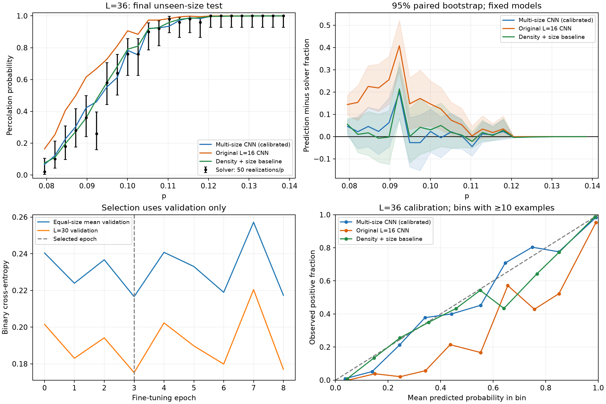

# Zero-Path Machine Learning

Can a model trained on smaller lattices predict zero-weight spanning-path
percolation on a larger lattice? This research prototype learns from ±J bond
realizations and the labels produced by an existing dynamic-programming solver.
The longer-term goal is to reproduce probability curves P(L,p) and assess their
use for finite-size scaling.

The latest experiment trains across **L=16,20,24,28,32**, uses **L=30 for size
validation**, and tests a frozen model on **L=36**. The repository includes the
trained model and the complete small final test ensemble, so the main CNN
metrics can be reproduced without the separate research code.

## Results on an unseen lattice size

Final test: 1,200 L=36 realizations, 50 at each of 24 p values. No final-test
rows were used for fitting, model selection or calibration.

| Model | Accuracy | Balanced accuracy | ROC-AUC | P(L,p) curve MAE |
|---|---:|---:|---:|---:|
| Always predict percolation | 73.50% | 50.00% | — | — |
| Original L=16 CNN | 88.33% | 78.99% | 0.9667 | 9.21 percentage points |
| Density + size logistic baseline, calibrated | 89.67% | 85.53% | 0.9631 | 2.24 points |
| Multi-size CNN, calibrated | **90.75%** | **87.07%** | **0.9670** | **2.51 points** |

Accuracy measures individual binary decisions at probability 0.5. Balanced
accuracy gives equal weight to the two classes. Curve MAE averages the absolute
difference between mean predicted probability and solver-positive fraction at
each p. The simple baseline still gives slightly better averaged curves;
classification accuracy alone does not establish an advantage for the physics.



A local CPU benchmark measured approximately **941× batched prediction
throughput** relative to the reference solver: the same 48 realizations,
one CPU thread for each, 138.713 s for one serial solver pass versus 0.14736 s
median over three CNN batches. CNN timing includes bond encoding. Loading,
warmup, sampling and file I/O are excluded; solver reconstruction is excluded.
This is an aggregate throughput measurement, with no GPU involved.

## Run the published model

Tested with Python 3.13. From a clone of this repository:

```bash
python3 -m venv .venv
source .venv/bin/activate
python -m pip install -r requirements-cnn.txt
python -m src.demo
```

Expected output includes 90.75% accuracy, 87.07% balanced accuracy, 73.50%
majority-class accuracy, ROC-AUC 0.9670 and curve MAE 2.51 percentage points.
The demo verifies artifact checksums, loads the frozen weights and runs inference
on the included test bonds. It requires no research solver and does not retrain.

```bash
python -m unittest discover -s tests -v
```

Solver-specific integration tests skip when the optional research solver is
absent. Model, boundary, split and public-demo checks still run.

## What the model learns

Each input contains L(2L−1) unique ±1 physical bonds: rightward bonds including
horizontal wrap, then downward bonds, both in row order. Horizontal boundaries
are periodic; vertical boundaries are open. Here p is the probability of a
negative bond. The target is the reference solver's binary total-percolation
decision. Averaging predicted probabilities over realizations estimates P(L,p).

The 13,489-parameter CNN uses bond planes and boundary masks, six dilated
convolutional layers, global mean/max pooling, negative-bond density and
log(L/16) in its prediction head. Sampling p and solver-derived path statistics
are not model inputs. Training uses binary cross-entropy and AdamW, followed by
validation-only size-dependent probability calibration. There are 16,800
eligible training rows; each epoch samples 840 from each training size. The
[experiment report](docs/multisize_results.md) gives the full split and metrics.

## Scientific limits and next experiment

Labels reproduce the existing bounded reference algorithm. A negative label is
not a mathematical certificate that no zero-weight spanning path exists.
The largest pointwise discrepancy is about 20 percentage points, despite the
2.51-point average curve error. Fifty realizations per p are insufficient for
precision scaling claims. Intervals condition on one frozen training run.

Neither the critical probability p_c nor exponent nu has been estimated with
this model; L=64 and path-length prediction are untested. First-found path
length targets are retained for later work. Next: freeze this model, collect a
larger independent solver audit near the discrepant p range, and quantify
probability bias before attempting finite-size-scaling fits.

## Explore and reproduce

- [Reproduction and optional solver setup](docs/reproduction.md)
- [Multi-size training protocol](docs/multisize_protocol.md)
- [Final evaluation and limitations](docs/multisize_results.md)
- [Earlier single-size experiment](docs/L16_training_results.md)
- [Earlier transfer experiment](docs/transfer_results.md)
- [Portable model, test ensemble and recorded metrics](artifacts/multisize_v1/)

`src/` contains dataset generation, baselines, training and inference; `tests/`
contains model and integration checks. Large development datasets and experiment
outputs stay in ignored `data/`, `models/` and `figures/` folders. The selected
public snapshot and figure live under `artifacts/` and `docs/assets/`.
